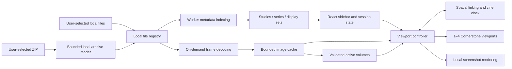

# MRI viewer implementation plan

Status: proposed implementation, incorporating confirmed first-version scope: desktop and tablet touch support, folder/file/ZIP import, linked scrolling, cine, MPR, and DICOM studies/series only. Research and local sample inspection: 2026-09-22. This document plans implementation; it does not claim browser rendering or performance has been verified.

## 1. Recommendation and feasibility

Build a static React + TypeScript application using Vite, Cornerstone3D, and its DICOM loader/tools. No application backend, upload endpoint, database, or DICOM server is needed for the initial scope. The hosting server delivers application code and bundled codecs; examination bytes are read from user-selected local files.

Cornerstone documents support for DICOM `File` objects and multiframe instances, plus separate stack and volume viewports. This supports the proposed local stack-viewing architecture. Actual codec, browser, and memory behavior must pass the first implementation milestone. [Image loaders](https://www.cornerstonejs.org/docs/concepts/cornerstone-core/imageloader/), [viewports](https://www.cornerstonejs.org/docs/concepts/cornerstone-core/viewports/).

There is no universal MRI study-size cutoff that requires a server. On-disk size, decoded frame size, concurrent viewports, browser limits, GPU memory, and operations all matter. Large collections of separate slice files can be read incrementally from local storage. A very large single compressed multiframe instance can be harder if its loader retains the entire compressed dataset. Full-volume reconstruction and 4D processing have different requirements from showing a few slices.

Use bounded local reads and caching for stacks, and explicitly budget full active volumes for MPR. If a case exceeds tested limits, explain the limit and allow stack viewing or a smaller selection. Do not silently upload it. Revisit a backend only for a concrete requirement such as PACS access, shared storage, or computation that fails a measured browser benchmark; choose Node/TypeScript versus Python then.

## 2. Findings from the supplied sample

Inspection used pydicom locally with pixel decoding disabled. No patient names, dates, study identifiers, filenames, or raw metadata values are included here.

| Property | Observed value |
| --- | --- |
| Files / studies / series | 433 / 1 / 8 |
| Total file bytes | 161,033,126, approximately 153.57 MiB |
| Instances per series | 23, 50, 60, 60, 60, 60, 60, 60 |
| Image class | Classic MR Image Storage, one frame per file |
| Encoding | JPEG 2000 lossless, transfer syntax `1.2.840.10008.1.2.4.90` |
| Pixels | 16-bit, MONOCHROME2; matrices from 512 × 512 to 704 × 704 |
| Decoded native pixel storage | Approximately 326.50 MiB for all images |
| Geometry and window metadata | Position, orientation, and window center/width present in every image |
| Geometry complication | First series contains three orientations; remaining seven each contain one |

The storage estimate excludes compressed buffers, parsing, workers, float conversions, rendering targets, and GPU textures. It is an architectural input, not a measured browser memory figure. This one examination is not evidence of a population-wide typical MRI size.

The transfer syntax is identified as JPEG 2000 lossless in the [Cornerstone transfer syntax reference](https://www.cornerstonejs.org/docs/api/dicomimageloader/namespaces/constants/variables/transfersyntaxes/). A listed constant alone does not prove every codec path works; decode this sample in the initial spike.

## 3. Product scope and interaction

Confirmed target: desktop and tablet, including touch interactions. Target current Chrome/Edge, Firefox, and Safari on desktop, plus iPadOS Safari and Android Chrome on tablets. Validate on real tablets; desktop browser emulation alone is insufficient for memory, GPU, file selection, and export behavior. Plan personal viewing; clinical workflows are outside the requested scope.

Touch controls: tap to activate a viewport; a visible tool selector defaults to Slices and determines whether one-finger dragging changes slice, pans, changes windowing, or moves the MPR crosshair. Pinch zoom and two-finger pan remain available. Provide large slider/button targets, tap-to-assign series, and no hover-only or right-click-only actions. Scope gesture capture to the imaging canvas so page/sidebar scrolling and accessibility remain usable. Adapt to portrait/landscape changes; the right sidebar can collapse into a right-side drawer on narrow tablets, with the selected series summary still visible. Validate interactions against the pinned library's [touch examples](https://www.cornerstonejs.org/docs/examples/).

### Import and examination browser

- Provide Open folder, Open files (multiple selection), and Open ZIP. Folder selection is the primary desktop workflow; ZIP is convenient for downloaded examinations and tablets. Support adding examinations to the current session and removing them.
- Recognize DICOM content, including extensionless media files. Handle DICOMDIR as an index if present, while also allowing direct folder scanning. Never execute bundled disc viewers.
- Show import progress, cancellation, partial results, duplicate counts, and actionable errors for unreadable or unsupported files.
- Keep the right sidebar organized as examination/study, series, then any necessary sub-stack or dimension selection. Different imports may contain the same study; group by DICOM identities, not folder names.
- Keep study description/date and series description/number/date, slice count, and orientation visible. Use sensible fallbacks when tags are absent; display an unknown value rather than invent one. Keep the selected series summary visible independently of list scrolling.
- Offer optional thumbnails, loaded lazily. Selecting a series assigns it to the active viewport; drag-to-viewport can be a convenience after click selection works.
- Show a clear active viewport border and series label. Each viewport retains its own slice, zoom, pan, and window settings.

Implement folder/file import first to validate the imaging pipeline, then ZIP as part of the first tablet-ready release. ZIP is a local container for DICOM files, not an additional imaging format; nested folders and extensionless DICOM entries feed the same importer. Its main benefit is packaging, since already-compressed pixel data may gain little further compression.

### Metadata dialog

Provide a searchable, virtualized tag browser showing tag number, dictionary name when available, VR, and value. Expand nested DICOM sequences and show unknown/private tags by their numeric identifiers. Binary data is represented by its type and byte length, not dumped as text.

The dialog must identify the selected instance/frame. A series has no single authoritative value for every tag: distinguish common series values from values that vary per instance. Allow switching instance/frame and viewing shared/per-frame functional groups. Parse full metadata on demand, support DICOM character sets, and keep raw tags out of logs and analytics.

### Top bar and viewing tools

- Previous/next slice, position slider, editable `current / total`, first/last, and keyboard/wheel/touch navigation. Controls act on the active viewport; ordinary navigation stops at stack boundaries. In MPR, identify the plane and reconstructed position; distinguish spatial and temporal navigation.
- Zoom, pan, fit-to-window, reset view, and contrast/brightness via DICOM window width/center. Initialize from DICOM VOI information when available and provide a computed fallback.
- Display orientation markers, current slice, and concise window/zoom information without obscuring the image. Preserve pixel spacing/aspect ratio and correct rescale, signedness, VOI, and MONOCHROME1 inversion where applicable.
- Keep source files immutable. Session display changes never rewrite DICOM files.

### Slice position / depth navigation contract

These are the proposed interaction defaults for implementation. Moving through a sequence means selecting a spatial slice, independently of magnification, pan, contrast, and time. Use the label **Slice** for acquired stacks and **Plane position** for MPR; avoid a generic "depth" value that could imply distance from the skin or a universal anatomical direction.

The top navigation bar identifies the active pane and sequence and contains: previous button, horizontal position slider, editable 1-based index / total (for example `24 / 60`), next button, and first/last actions. Keep a compact readout in each pane so comparisons remain understandable. Show acquisition/reconstruction plane and, when geometry is trustworthy, distance in millimeters from that stack's first plane. Label the latter as a relative position, not an anatomical measurement. Display the direction toward increasing index from geometry; a higher index does not always mean deeper into the body. Mixed-orientation series require a sub-stack selection before spatial navigation.

| Input | Default behavior |
| --- | --- |
| Mouse wheel over a pane | Down advances one slice per wheel notch; up goes back. Intentional scrolling activates that pane; hovering alone does not. Wheel remains slice navigation when Pan or Window tools are selected. |
| Trackpad vertical scroll | Accumulate normalized scroll deltas into slice steps, with an adjustable sensitivity; avoid mapping every tiny event to a frame. Horizontal scrolling does not change slice. Preserve browser Ctrl/Cmd-wheel zoom behavior. |
| Mouse drag in Slices mode | Drag upward to advance and downward to go back; useful without a wheel. Other tool modes retain their own drag action. |
| Tablet one-finger drag in Slices mode | Drag upward to advance and downward to go back. Use distance-based steps with a small dead zone and no application-added inertia; taps only activate the pane. |
| Tablet two-finger gestures | Pinch zoom; two-finger translation pans. Neither changes slice. Cancel the one-finger slice gesture when a second finger joins, without a jump. |
| Top-bar slider | Drag/scrub to any slice; the thumb represents ordered slice index. Snaps to actual slices, with live preview and the final target guaranteed on release. |
| Previous/next buttons | Move exactly one slice; disabled at the respective boundary. Touch targets at least 44 CSS pixels. |
| Editable slice number | Enter an integer in `1..N` and press Enter or confirm; reject invalid values with inline feedback. Escape restores the displayed index. |
| Keyboard in viewer focus | Up/Down = previous/next; Page Up/Page Down = minus/plus 10; Home/End = first/last. Clamp at endpoints. Space toggles cine. |

Scope keyboard shortcuts to viewer focus and keep the last active pane as the toolbar target. Do not intercept typing, dialog controls, sidebar navigation, or a focused button's native keyboard action. A focused slider uses standard arrow/Home/End behavior without also invoking viewer shortcuts. Allow Tab navigation, provide accessible labels/current values, and announce the settled position rather than every frame during scrubbing.

Slice order is the stable spatial order defined by the importer, not filename order or DICOM InstanceNumber where reliable geometry exists. Slider spacing represents indices even for nonuniform acquisitions; the millimeter readout must use actual geometry. If spatial metadata is unavailable, show only index/total and an ordering warning. Never fabricate physical depth or enable spatial linking in that case.

### Navigation state, loading, and boundaries

- On first opening a display set, select its middle slice (`floor((N - 1) / 2)` internally). Restore the last position when returning to that display set in the same pane/session. A newly assigned member of an active link group follows the group's valid physical position when possible.
- Stop at the first/last slice; manual navigation never wraps. A single-image display set shows `1 / 1` with spatial navigation disabled. Cine may wrap only when its Loop option is enabled.
- Maintain position per pane and display set, separately from camera/window state. Navigating slices preserves zoom, pan, and windowing. Fit/reset-view does not reset slice position; layout changes preserve it.
- Any manual position change pauses cine in that pane, or its whole linked playback group, before applying the change. Temporal/echo/diffusion selectors are separate controls; spatial scrolling never silently switches those dimensions. Switching a dimension preserves the nearest valid spatial position when geometry allows.
- Use a latest-target-wins request policy during fast scrubbing: prioritize the requested frame, cancel obsolete queued work, and prevent an older decode completion from replacing a newer selection. Prefetch a bounded neighborhood in the navigation direction.
- Distinguish requested and displayed positions while decoding: keep the last rendered image labeled with its actual index and show a pending/loading indication for the target. On failure, identify the failed target and allow retry or further navigation; do not silently label an old image as a new slice.

### Linked position and MPR navigation

When linking is off, every pane navigates independently. When on, navigation in any member makes it the source of that interaction and propagates a patient-space position to compatible targets. Different slice spacing/counts may therefore produce different indices, for example `24 / 60` alongside `20 / 50`. If the requested physical position falls outside a target's coverage or tolerance, leave its last valid image visible with an explicit out-of-range indicator; do not imply it is matched. Returning to overlap resumes matching.

For an MPR pane, wheel/drag/slider moves its plane along its normal. Define a stable position range and reconstruction step from the volume geometry for each axial/sagittal/coronal preset; show step size and reconstructed index/total. Do not reuse acquired slice count or SliceThickness indiscriminately for all three axes. These positions are reconstructed samples, not additional acquired images.

The MPR preset starts at the volume center with a shared crosshair. Moving a plane updates the crosshair's patient-space coordinate along that plane's normal and updates linked crosshair displays. In the explicit Crosshair tool, tapping/clicking a point or dragging the crosshair selects an in-plane location and moves the other reconstructed planes to intersect it. Ordinary interaction in Pan, Window, or Slices mode must not reposition the crosshair in-plane. Crosshair navigation works with mouse and touch and does not create a saved annotation.

### Layouts

| Count | Layouts |
| --- | --- |
| 1 | Single viewport |
| 2 | Side by side; stacked vertically |
| 3 | One large left with two stacked right; one large top with two below |
| 4 | 2 × 2 grid; four columns or four rows where screen size permits |

Allow splitter resizing with minimum viewport sizes. Preserve viewport assignments/settings when switching layouts; hide excess viewports and release their rendering resources while retaining lightweight session state. Support comparing different studies and opening the same series in more than one viewport.

The four-pane limit counts actual rendered panes, including MPR planes. A three-plane MPR preset occupies three panes; a fourth may show another sequence or an original stack. Each pane can be assigned a stack or an axial, sagittal, or coronal reconstruction. Share one volume across its MPR panes rather than allocating a volume per pane.

### Linked scrolling, cine, and MPR (first version)

Linked scrolling is opt-in per viewport group. For compatible parallel stacks, map the physical position to the nearest target slice with an overlap/distance check. Require valid geometry and a matching FrameOfReferenceUID; a shared frame of reference still requires geometric compatibility. Nonparallel MPR planes use a shared patient-space crosshair instead of matching slice indices. Disable unsupported links with an explanation, avoid synchronization event loops, and leave contrast/zoom independent by default. Cross-examination registration is deferred. [Cornerstone synchronizers](https://www.cornerstonejs.org/docs/concepts/cornerstone-tools/synchronizers/), [slice-position matching](https://www.cornerstonejs.org/docs/api/tools/namespaces/synchronizers/functions/imageslicesynccallback/).

Cine includes play/pause, speed, reverse, loop, and bounce. Distinguish an animated sweep through spatial slices from time playback at a fixed spatial position. Honor frame timing when supplied; use a user-selected rate otherwise. Use one leader clock for linked panes, bounded prefetch, and backpressure when decoding cannot keep up. Pause on study removal, hidden tabs, and export; capture a stable frame for screenshots. The supplied study only tests spatial cine, so synthetic/public temporal data is required. Full-volume 4D MPR playback is deferred; ordinary temporal DICOM frame playback is included. [Cine options](https://www.cornerstonejs.org/docs/api/tools/namespaces/types/namespaces/cinetypes/type-aliases/playclipoptions/).

MPR means axial/sagittal/coronal reconstruction from a geometrically valid 3D series, with shared crosshair navigation, orientation labels, and reset. Oblique plane rotation, thick-slab MIP, and 3D surface/volume rendering are future extensions. Validate consistent orientation, spacing, dimensions, and scalar characteristics before creating a volume; tolerate numerical noise but reject unsupported gaps/nonuniform geometry. Mixed localizer planes remain available as stacks. Display loading progress and cancellation, and label reconstructions as such. The sample's roughly 3.3 mm slice spacing versus finer in-plane spacing means reconstructed detail is anisotropic; interpolation cannot recover missing resolution. [Volume viewports](https://www.cornerstonejs.org/docs/concepts/cornerstone-core/viewports/).

### Screenshot export

Export either the active viewport or the whole imaging workspace, excluding the toolbar/sidebar. Offer PNG and JPEG, with JPEG quality, output pixel dimensions, and aspect-ratio lock; screen-size, 2×, and custom dimensions are sufficient presets.

Capture exactly the selected frames, pan, zoom/crop, windowing, and layout. Re-render at target size with the same field of view, wait for rendering to complete, and compose viewports into an export canvas. Do not simply stretch the screen bitmap. Higher resolution does not create new scan detail. Bound output size using tested canvas/GPU limits and an allocation budget.

Make overlays an explicit option, defaulting identifying overlays off; use a generic filename. This does not remove identifiers already burned into source pixels. Reserve a separate overlay composition layer for future measurements. Verify exported MIME type and dimensions rather than relying on filename extensions. Cornerstone provides canvas-rendering utilities to evaluate during the spike. [Canvas rendering](https://www.cornerstonejs.org/docs/api/core/namespaces/utilities/functions/rendertocanvasgpu/).

## 4. Library and stack decisions

| Choice | Assessment for this project |
| --- | --- |
| React + TypeScript + Vite | Requested UI stack; a small static SPA is sufficient. No SSR requirement. |
| Cornerstone3D core, DICOM loader, tools | Recommended imaging foundation for stacks, MPR volumes, cine, synchronization, and touch; measurement tools remain a later extension. |
| OHIF | A capable alternative if ready-made clinical workflows become central. Its modes/extensions platform introduces more application structure than this custom UI currently needs. |
| NiiVue | Strong candidate for future research/neuroimaging formats; evaluate an adapter if needed rather than introducing a second renderer now. |
| DWV | Another browser DICOM library with local loading and viewing tools. Retain as a fallback candidate; its GPL-3.0 license needs to fit the distribution model. |

The library assessments above are engineering judgments based on the documented capabilities: [Cornerstone scope](https://www.cornerstonejs.org/docs/getting-started/scope/), [OHIF architecture](https://docs.ohif.org/development/architecture/), [NiiVue formats](https://niivue.com/docs/loading/), [DWV repository](https://github.com/ivmartel/dwv).

Use a small session store, provisionally Zustand, for UI state. Keep pixel buffers, `File` references, renderers, and worker objects outside React state. Use Vitest for grouping/geometry/export logic and Playwright for actual import/viewing flows. Pin a mutually compatible set of imaging packages and commit the lockfile after the spike; audit codec dependencies/licenses at that point.

Metadata integration is a spike decision: current Cornerstone documentation describes a newer `@cornerstonejs/metadata` path and marks some older `wadouri` metadata APIs deprecated. Prefer the supported path in the chosen stable release; avoid mixing examples from different major versions. Use `dicom-parser` only where necessary for bounded indexing/raw-tag access, behind the DICOM adapter, and avoid retaining duplicate full datasets. [Loader metadata integration](https://www.cornerstonejs.org/docs/api/dicomimageloader/variables/wadouri/), [dicom-parser partial parsing](https://github.com/cornerstonejs/dicomParser).

## 5. Architecture and data flow

Keep these boundaries explicit without building a general plugin framework:

- `LocalSourceRegistry`: session IDs mapped to files, sizes, and local reads; cancellation and release.
- `ZipSource`: archive entry identities and on-demand local extraction, exposed through the same source interface as ordinary files. Keep archive handling separate from DICOM parsing and rendering.
- `FormatAdapter`: content detection, indexing, normalized frame metadata, frame access, and raw metadata inspection.
- `StudyCatalog`: study/series identities and a list of renderable `DisplaySet`s. A display set is an ordered compatible stack, not necessarily a whole DICOM series.
- `ViewportController`: renderer lifetime, assignment, camera/window state, navigation, resize, and events.
- `VolumeManager`: geometry validation, memory admission, cancellable volume preparation, shared references, and release.
- `SynchronizationController`: physical-coordinate linking, crosshair state, and cine leadership without event feedback loops.
- `ExportService`: immutable snapshot of presentation state, temporary rendering, composition, and local download.
- `ToolRegistry`: input bindings and capabilities, initially read-only tools; later measurement tools.

Normalize frames with source/frame references, pixel characteristics, geometry when present, and dimension keys. Preserve native format metadata separately. Future formats without a DICOM study/series hierarchy get a session-local dataset grouping rather than fabricated DICOM identifiers.

Suggested directories: `src/app`, `src/features/import`, `src/features/study-browser`, `src/features/viewer`, `src/features/metadata`, `src/features/export`, `src/imaging/{sources,formats,rendering,tools}`, and `src/workers`.

### DICOM grouping and ordering

1. Group by StudyInstanceUID and SeriesInstanceUID; deduplicate instances using SOPInstanceUID. Flag conflicting files with the same UID rather than silently overwriting them.
2. Extract dimensions and shared/per-frame metadata. Split incompatible orientations, matrix sizes, image types, temporal positions, echoes, and diffusion dimensions where needed. Preserve the original series as the sidebar parent.
3. Within a spatial stack, order by projection of ImagePositionPatient onto the normal derived from ImageOrientationPatient. Use tolerances for floating-point geometry; retain original indices for traceability.
4. With insufficient geometry, fall back to InstanceNumber and stable import order, clearly marking spatial ordering as unavailable. Never infer anatomical order from filename sorting.
5. Treat missing slices, duplicate positions, mixed orientations, and nonuniform spacing explicitly. Do not create a fake volume from an inconsistent stack. The sample's first series is a required mixed-orientation acceptance case.

Patient-space geometry follows the [DICOM Image Plane Module](https://dicom.nema.org/medical/Dicom/2023c/output/chtml/part03/sect_C.7.6.2.html). Enhanced MR adds functional-group and multidimensional handling; generic multiframe decoding alone is not sufficient. [Enhanced MR modules](https://dicom.nema.org/MEDICAL/dicom/2026a/output/chtml/part03/sect_A.36.2.3.html).

### Initial DICOM compatibility boundary

Ship classic monochrome MR stacks first, with tested uncompressed little-endian and sample JPEG 2000 lossless paths. Add codec fixtures for JPEG lossless, JPEG-LS, RLE, and other supported encodings before advertising them. Detect Enhanced MR/multiframe and provide correct frame/dimension navigation before calling it supported; include a compatibility milestone before the first general DICOM release.

Vendor mosaic images, spectroscopy, DICOM SEG/SR, presentation states, encapsulated PDFs, and other non-image objects are separate capabilities. List unsupported objects with an explanation; never present an incomplete decode as a valid image. Plain PDF reports are out of scope for now.

## 6. Local access, performance, and privacy

Use `<input type="file" multiple>` and folder selection with `webkitdirectory` as the baseline. Add drag/drop with directory traversal where supported. `showDirectoryPicker()` is optional, because it has limited browser availability. Browsers require the user to select files; a web app cannot open an arbitrary absolute filesystem path itself. [Folder input](https://developer.mozilla.org/en-US/docs/Web/API/HTMLInputElement/webkitdirectory), [directory picker](https://developer.mozilla.org/en-US/docs/Web/API/Window/showDirectoryPicker).

Index metadata in a worker with bounded concurrency, progressively reading local `Blob` slices where supported by the parser. A fixed prefix is not guaranteed to contain the complete header; grow reads or use a controlled fallback for large/deflated datasets. Keep only compact catalog metadata. Parse the full tag view on request. [Local Blob slicing](https://developer.mozilla.org/en-US/docs/Web/API/Blob/slice).

### ZIP import

Keep archive processing entirely in-browser. Retain the original selected `File`, index its entries, and read/extract entries incrementally in workers with bounded concurrency. Do not load the entire ZIP into an ArrayBuffer or retain every extracted DICOM file. Evaluate a library with streaming extraction, such as [fflate](https://github.com/101arrowz/fflate); verify efficient entry access and ZIP64 needs before choosing the final package. Streaming support alone does not guarantee efficient random access.

Metadata indexing may require inflating each compressed entry. Cache only compact metadata and a bounded working set of extracted entries; re-extract evicted entries from the original archive when needed. Account for extraction buffers within the existing device memory budget, separately from decoded-pixel caching, and benchmark repeat-navigation CPU cost. No persistent extracted copy is required in the first release.

Support ordinary unencrypted ZIP archives containing stored or DEFLATE-compressed files, including nested directories and DICOMDIR relative references. Reject encrypted, multipart, nested archives, and unsupported compression methods with clear messages; ignore unrelated files. Use archive-plus-entry IDs rather than filenames alone, validate paths and duplicate entries, and never write archive paths to the host filesystem.

Show indexing/extraction progress, cancellation, and per-entry failures. Enforce configurable limits on entry count, per-entry expanded bytes, and total expanded bytes processed; check actual output while extracting rather than trusting declared sizes. Stop before exhausting the current memory profile and offer folder/file import after external extraction when an archive exceeds supported limits. Keep partial imports clearly marked and release temporary buffers on cancellation/removal.

Decode visible frames first, prefetch a small neighboring range, and cancel stale work when the user changes series or scrolls rapidly. Use a shared bounded decoded-image cache and separately account for compressed datasets, worker buffers, thumbnails, GPU allocations, and export canvases. Begin with a conservative configurable cache budget, provisionally 256 MiB on desktop and 128 MiB on tablet, then tune on real devices. These are initial budgets, not detected device capacities or guarantees. Cornerstone's image cache is useful but does not by itself bound total process memory. [Cache behavior](https://www.cornerstonejs.org/docs/concepts/cornerstone-core/cache/).

MPR needs a separate admission check before retaining/allocating a volume: estimate native pixels, possible converted buffers, GPU textures, and rendering/export targets. Share volumes across panes, release them when unused, and prioritize the active reconstruction. A largest individual sample series has approximately 56.72 MiB of native pixels; several active series and GPU copies can multiply that. Test one-volume and multi-volume layouts on tablets in milestone 0. If a requested combination exceeds the tested budget, keep stack viewing available and explain which volume must be closed; don't silently downsample the scan. Cancel queued volume work on navigation and avoid caching every time point of a temporal study.

Bundle and serve codecs, workers, fonts, and scripts from the application's origin. No third-party runtime assets, scan telemetry, remote error payloads, or medical-data URLs. Keep examinations in memory for the session; persist only non-sensitive UI preferences by default. Closing/removing a study releases source references, caches, workers/tasks where appropriate, and object URLs.

After application assets are loaded, local viewing should continue with the network disabled. If reopening the application completely offline is desired, add an app-shell service worker that caches only application assets, never examination data. Validate the distinction explicitly.

Serve production over HTTPS and local development over localhost. Test WASM MIME types, worker paths, CSP, and the actual production bundle. Choose headers based on the pinned codecs/runtime; don't assume SharedArrayBuffer or cross-origin isolation is universally required.

### Provisional hardware baseline and budgets

The user authorized reasonable minimum-resource assumptions. These are planning estimates for this sample and similarly sized active series, not measured compatibility guarantees or universal limits on study size. Confirm or revise them in milestone 0.

| Resource | Desktop minimum / recommended | Tablet minimum / recommended |
| --- | --- | --- |
| Physical RAM | 8 GiB / 16 GiB | 4 GiB / 8 GiB |
| CPU | Modern 64-bit, about four logical cores; start with two decode workers | Modern 64-bit mobile processor, about four cores; start with one or two decode workers |
| Graphics | Integrated GPU with working WebGL 2 and 3D textures is sufficient as the initial assumption | Working WebGL 2 and 3D textures; validate on actual iPadOS/Android hardware |
| Browser runtime | Current supported browser with WebAssembly, workers, and local file input | Same capabilities plus working touch and local-file/export workflows |
| Disk | Original examination plus exported screenshots; no required second browser-managed copy | Same; cloud-backed files must be locally available if offline viewing is required |

Core count and physical RAM are coarse proxies. Browser/GPU allocation limits can be much lower than installed RAM, and mobile tabs can be terminated by the OS. Query WebGL capabilities, handle allocation/context errors, and offer a visible Standard / Low memory setting; do not depend on `navigator.deviceMemory` being available or reliable.

Initial budget profiles:

- Desktop: 256 MiB decoded-image cache; target about 1 GiB incremental viewer memory including tracked CPU/GPU allocations during ordinary sample workflows. Start with at most two concurrently resident distinct MPR volumes, admitted by estimated byte size; other panes can show stacks or share those volumes.
- Tablet: 128 MiB decoded-image cache; target roughly 512 MiB incremental viewer memory for normal sample use, with a conservative estimated admission ceiling around 768 MiB. Start with one resident MPR volume, shared across up to three reconstructed planes, plus a fourth stack pane. Returning another volume to stack mode frees its reconstruction budget.
- Cap decoding concurrency and account for transient compressed/decoded copies. Cache limits are included within the overall target, not additional allowances. Full browser/GPU memory is not consistently observable from JavaScript; budget estimates must be checked using device/browser profiling.
- Initially cap custom exports at 4096 pixels per side and 16 megapixels on desktop, or 2048 pixels per side and 4 megapixels in the tablet profile, further constrained by actual canvas/GPU limits and free budget. Allow larger profiles only after validation. Render export panes sequentially to reduce peak memory; provide a smaller-size retry if allocation fails.

For scale, one 704 × 704 × 60 volume contains about 56.72 MiB of 16-bit pixels, or 113.44 MiB if a full float32 representation is required. That makes a sample-sized single-volume MPR workflow plausible within these budgets, while emphasizing why retaining all series/representations is unnecessary. This is a byte-count estimate, not an assertion about the pinned renderer's exact allocations.

Two-GiB tablets are outside the initial full-feature support target; stack-only viewing may work but is best effort. A device that cannot run MPR within budget gets a clear explanation and working stack controls, never an automatic upload. If minimum-spec testing disproves a budget assumption, revise the published requirement before release rather than claiming support.

## 7. Implementation milestones and acceptance

| Milestone | Deliverable | Exit condition |
| --- | --- | --- |
| 0. Compatibility spike | Minimal React/Vite local loader; JPEG 2000, four panes, touch, linked positioning, cine, MPR, export probes | All sample files decode; valid sample series reconstructs correctly; mixed localizers excluded from invalid volumes; desktop and real tablet measurements; offline viewing after assets load; pinned versions |
| 1. Import and catalog | File/folder selection, cancellation, worker indexing, grouping, deduplication, error reporting | Sample imports as one study/eight original series with appropriate sub-stacks; adding/removing studies works; no image network requests |
| 1b. ZIP source | Local archive selection, bounded worker extraction, shared DICOM importer, progress/cancellation and limits | A ZIP of the sample produces the same catalog and rendered pixels as folder import; real tablet selection works; cancellation, corrupt entries, and expanded-size limits handled without an upload or full-archive memory allocation |
| 2. Single viewport and touch | Right sidebar/drawer, basic metadata, tag dialog, slice-navigation contract, zoom/pan/window/reset | Wheel/trackpad, touch drag, slider, exact index and keyboard agree; boundaries/focus respected; sample stacks correctly ordered; metadata reflects displayed frame; failed loads never mislabel an image |
| 3. Comparison and playback | 1–4 viewports, layouts, resize, active viewport, linked scrolling, spatial/temporal cine | State survives layout changes; links use physical position; playback timing/backpressure tested; rapid switching cannot display stale frames |
| 4. MPR | Geometry checks, volume lifecycle, three-plane preset, crosshair, per-pane plane choice | Known landmarks align across planes; anisotropic spacing handled; invalid volumes rejected; memory-limited cases retain working stacks; touch works on real tablets |
| 5. Screenshot export | Stack/MPR workspace capture, PNG/JPEG, size/quality/overlay controls | Export preserves crop/window/crosshair/layout at exact dimensions; cine captured consistently; desktop/tablet download and allocation limits verified |
| 6. Compatibility and release | Additional DICOM fixtures, browser/device matrix, large-study tests, privacy checks, accessible controls | Published supported SOP/transfer-syntax matrix and device limits; explicit unsupported paths; production/offline checks pass |

All milestones are part of the first version. MPR and tablet feasibility are tested at the start even though the complete interfaces are built later.

### Verification strategy

- Unit fixtures: shuffled spatial order, oblique slices, mixed localizers, duplicate UIDs/positions, missing tags, multi-echo/time dimensions, character sets, and signed/unsigned pixels. Use synthetic or approved public data in Git.
- ZIP fixtures: stored/DEFLATE entries, nested folders, extensionless DICOM, DICOMDIR references, duplicate names, malformed/truncated archives, invalid paths, excessive entry counts/expansion, and rejected encrypted/multipart/nested archives. Verify folder/ZIP catalog and pixel equivalence, cancellation cleanup, bounded extraction memory, and re-reading evicted entries. Keep any ZIP of the real sample under ignored `local-data/`.
- Rendering fixtures: known pixel ramps/3D landmarks for rescale/windowing, inversion, aspect ratio, orientation, MPR, and crosshair correspondence. Test different slice spacing, nonparallel sequences, out-of-range links, and absent/mismatched frame-of-reference IDs. Verify selected real sample slices/reconstructions locally against a trusted viewer; don't commit private screenshots or metadata snapshots.
- Browser integration: import, cancel/re-import, four viewports, layouts, keyboard and touch navigation, dialog access, linked scrolling, cine, MPR, and exports; also block network after assets are loaded and assert local viewing still works. Real-device tests cover iPadOS file selection/downloads, Android touch, portrait/landscape resize, and memory pressure.
- Navigation acceptance: all input methods reach the same target; first/last and single-frame boundaries; middle-slice initialization and per-pane restore; sidebar/dialog/keyboard focus isolation; smooth trackpad accumulation; one-to-two-finger transitions; rapid forward/back scrubbing with deliberately out-of-order decode completions; failed targets; pause-on-manual-navigation; linked stacks with different spacing/coverage; MPR plane steps and crosshair agreement. Verify that changing zoom or time never accidentally changes the spatial position.
- Privacy/build: inspect requests for any scan content or identifiers; verify private directories are neither tracked nor in `dist`, static hosting, or development-server responses. Keep private sample tests local and opt-in; do not upload their failure artifacts to CI.
- Performance: benchmark the real sample, then generated 1 GiB and 5 GiB slice collections plus a large multiframe fixture. These are test scales, not promised support limits. Record indexing time, first-frame latency, cold/warm scroll latency, memory, and four-viewport behavior on named hardware/browser versions.
- Provisional desktop targets: visible import feedback within 250 ms, sample index/first usable image within 5 seconds, cached slice changes below 50 ms p95. Establish tablet, MPR preparation, and sustained cine targets on named hardware in milestone 0; report achieved playback rate instead of claiming the requested rate when decoding falls behind. Test cancellation, memory-pressure recovery, GPU context loss, and file access failures as well as the happy path.

## 8. Future extensions

1. Measurements: add ruler/length and angle tools through the tool layer. Store annotation points in patient/image coordinates with frame references, calibrated units, and later undo/redo/export. Do not tie annotation coordinates to screen pixels or change source files. Physical measurements require trustworthy spacing metadata.
2. Formats: prioritize NIfTI (`.nii`, `.nii.gz`), then NRRD (`.nrrd`, `.nhdr` plus companion data); consider MHA/MHD and MGH/MGZ based on actual demand. Preserve affine orientation, spacing, scalar type, and time dimensions. Evaluate Cornerstone's NIfTI loader first; local compressed-file memory behavior is a separate test. [NIfTI loader evolution](https://www.cornerstonejs.org/docs/migration-guides/2x/nifti-volume-loader/).
3. Advanced viewing beyond the first version: arbitrary oblique MPR, thick slabs/MIP, 3D rendering, full-volume 4D cine, richer reference lines, and registered cross-examination comparison. Registration is distinct from same-coordinate-system linking; matching slice numbers is insufficient.
4. Persistence/sharing: explicit local session save/reopen and only later optional remote sources. Browser file permission renewal must be handled; ordinary `File` objects do not survive a reload. Backend language remains undecided until a backend requirement exists.

## 9. Confirmed scope and remaining decisions

Confirmed by the user:

1. Desktop and tablet, including touch interactions.
2. Linked scrolling, cine playback, and MPR are all included in the first version.
3. DICOM studies and series only; PDF reports are out of scope for now.
4. Folder and multiple-file import first, followed by ZIP import before the first tablet-ready release; all processing remains local.

Resource assumptions are authorized: use the provisional 8 GiB desktop / 4 GiB tablet minimums and documented budgets above, then validate them. Additional choices worth settling before their milestone: offline reopening via an app-shell cache; remembering sessions across reloads; screenshot overlay defaults; and specific tablet models available for validation. Independent prior-examination comparison is supported; registered cross-examination linking is deferred. None of these choices requires a server by default. Until specified, reopen files or archives each session and omit identifying screenshot overlays.

## 10. Repository preparation completed

The repository was already initialized with an initial commit; its history was preserved. Added `.gitignore` before copying the private sample into `local-data/dicom/`. The private directory and common medical extensions are ignored. All real files, including extensionless DICOM, PDFs, archives, derived exports, and metadata dumps, must remain in ignored private directories. `.gitignore` can be bypassed with force-add, so review tracked files and add a medical-data guard to the implementation's commit/CI checks.

No viewer application, build setup, or browser tests have been implemented in this planning step.
